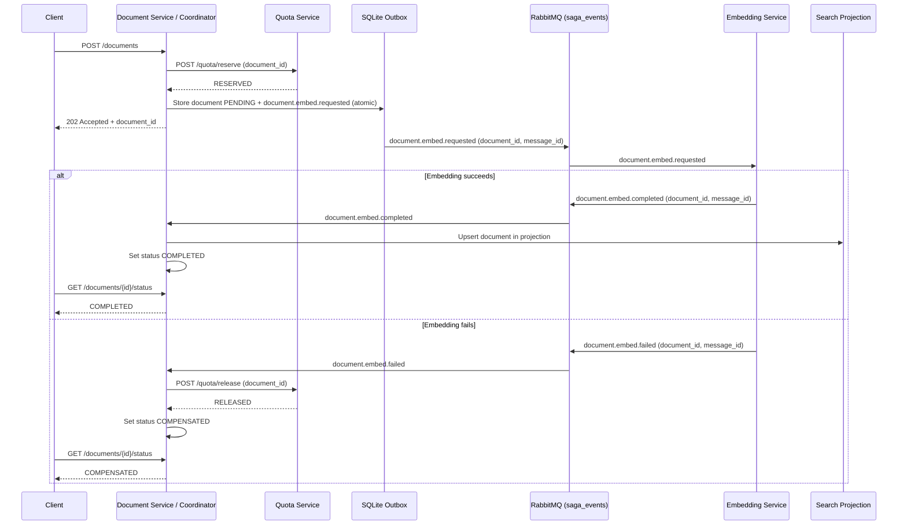

# COMP41720 Distributed Systems — Lab 2

This repository contains the Lab 2 document-ingestion saga implementation and
its interactive test harness. The assessed work covers document ingestion,
quota reservation and compensation, asynchronous embedding, and an eventually
consistent search projection.

## Implementation

The services use these local endpoints:

| Service | Port | Responsibility |
| --- | ---: | --- |
| Quota Service | 8081 | Reserve and release a tenant's document quota |
| Document Service | 8082 | Accept documents, coordinate saga feedback, expose status and projection |
| Embedding Service | 8083 | Consume embedding requests and publish completion or failure events |
| RabbitMQ | 5672 / 15672 | Durable topic exchange and management UI |

`POST /documents` reserves one quota unit synchronously, then stores the
document as `PENDING` and inserts a `document.embed.requested` event into the
SQLite outbox in the same database transaction. The relay publishes the event
to the durable `saga_events` topic exchange. The Embedding Service consumes the
request and publishes either `document.embed.completed` or
`document.embed.failed`. The Document Service listens for these feedback
events. A successful event marks the document `COMPLETED` and writes its
content to the search projection. A failed event triggers a quota release and
marks the document `COMPENSATED`.

Each event carries `document_id`, which is the saga's correlation identifier,
and a `message_id` used by consumers for deduplication. The API returns HTTP
202 and the document ID; query the result with
`GET /documents/{id}/status`. The projection is separately observable at
`GET /projection/{id}`.

### State and idempotency notes

The current implementation reports `PENDING`, `COMPLETED`, or
`COMPENSATED`; it does not write the literal `FAILED` status. The embedding
consumer's processed-message set is in memory, while the coordinator records
processed message IDs in SQLite. Quota reserve/release calls are deduplicated
with tenant/document keys rather than the RabbitMQ message ID. These guards
reduce duplicate effects, but they do not provide durable, message-ID-based
deduplication at every consumer across process restarts.

The coordinator catches errors from the quota-release request without checking
the response and still records/acknowledges the failure event. Therefore a
`COMPENSATED` status is not proof that quota was successfully released. This
is a limitation of the current implementation, not a guarantee of the saga.
Likewise, the body uses `document_id` as the correlation value rather than a
separate field named `correlation_id`.

## Running locally

Start RabbitMQ with its management plugin enabled and make its broker
(`localhost:5672`) and UI (`http://localhost:15672`) available. From the
`comp41720-lab2` directory, start each service in a separate terminal:

```sh
python -m uvicorn services.quota_service:app --host 0.0.0.0 --port 8081
python -m uvicorn services.document_service:app --host 0.0.0.0 --port 8082
FAILURE_RATE=0.0 python -m uvicorn services.embedding_service:app --host 0.0.0.0 --port 8083
```

The Python environment needs FastAPI, Uvicorn, Pika, and Requests installed.
The harness itself uses only the Python standard library:

```sh
python services/lab2_harness.py --quick
python services/lab2_harness.py --window
python services/lab2_harness.py
```

`--quick` checks the happy path. `--window` measures 20 accepted requests by
default. The full interactive run also pauses for failure injection and asks
for live confirmation where a quota-state endpoint is unavailable. Set
`FAILURE_RATE=1.0` on the Embedding Service and restart it when prompted, then
restore `0.0` for the recovery check. The RabbitMQ UI default credentials in a
local development setup are commonly `guest` / `guest`; use the credentials
configured for your broker.

## Task A — Document-ingestion saga

The forward path is event-driven after the initial synchronous quota
reservation: the transactional outbox publishes the embedding request, and
the service that produces the result publishes a completion or failure event.
The Document Service acts as a saga coordinator for terminal state and
compensation, while the Embedding Service reacts to the request event. This is
a coordinator-led, event-mediated saga rather than a pure choreography.

`GET /documents/{id}/status` makes the local saga state visible. During
processing, a client may see `PENDING`; after successful embedding and
projection update it sees `COMPLETED`; the current failure terminal state is
`COMPENSATED`.

## Task B — Consistency verification and evidence

Run the harness against the live services and retain its output and the
requested RabbitMQ UI screenshots with the repository. No measured run output
or screenshots are included in this checkout; values below must be copied from
the actual run before using this README as submission evidence.

| Check | Evidence to retain | Result |
| --- | --- | --- |
| Compensation, `FAILURE_RATE=1.0` | Harness output, service logs showing failure event and quota release, RabbitMQ UI screenshots, final status and quota | Not recorded in this checkout |
| Duplicate delivery | Redeliver a consumed event (or exercise relay redelivery); capture the consumer's duplicate-rejection log and confirm no repeated effect | Not recorded in this checkout; the supplied harness does not run this check |
| Inconsistency window, `FAILURE_RATE=0.0` | `--window` output for at least 20 accepted requests; also measure projection visibility if that is the reported projection lag | Not recorded in this checkout |

The supplied harness measures POST-to-`COMPLETED` status latency. It does not
measure POST-to-search-projection visibility, and it does not perform the
duplicate-delivery test. Record the 20-request run here; do not substitute
status latency for projection latency:

| Measurement | Min | Median | Max | Requests |
| --- | ---: | ---: | ---: | ---: |
| POST accepted → status `COMPLETED` (harness) | — | — | — | — |
| POST accepted → projection visible (if measured) | — | — | — | — |

Save screenshots in a repository evidence directory and list their filenames
here once captured. Do not include credentials in screenshots.

### Written analysis: observable anomalies and first mitigation

The workflow is eventually consistent, so a client can observe intermediate
states. Immediately after receiving `202 Accepted`, the document can still be
`PENDING` and absent from the search projection. Even after an embedding
request succeeds, the completion event must reach the Document Service before
the projection and terminal status are updated. Search clients can therefore
temporarily miss an accepted document. On the failure path, quota is reserved
before embedding finishes, so usage can temporarily include a document that
will fail. It should be returned when compensation succeeds. In this
implementation, a failed release can be hidden while the document is marked
`COMPENSATED`, so the reported status can overstate the global outcome.

The first mitigation I would deploy is durable, retryable compensation: persist
the compensation intent, check the release response, retry with backoff, and
only report compensation complete after the quota service confirms release.
This addresses the most consequential stranded state without blocking the
request path. The cost is additional durable state, retry/dead-letter handling,
monitoring, and a longer period in which the saga remains visibly pending
compensation. For search freshness, clients should separately treat status and
search visibility as distinct facts; the status endpoint alone is not a
read-your-writes guarantee for search.

## Task C — Appendix A

### Consistency model and suitability

The code implements **eventual consistency across services**, with a local
SQLite transaction for the document and outbox record and a separately updated
search projection. Quota reservation is a synchronous call but is not in the
same transaction as the document write. Terminal saga status is a local
observation of event handling, not a distributed atomic commit, and the
implementation does not ensure that a reported `COMPENSATED` state proves
quota release. It is not appropriate as-is for a banking ledger: ledger
balances require durable, auditable, strongly controlled accounting
invariants, not best-effort event handling and in-memory deduplication. A
model registry serving inference can often tolerate eventual search/catalog
visibility, provided deployments use immutable versions, enforce validation
and serving-safety gates, and make the active-version decision authoritative.
This implementation would need stronger durable processing and compensation
before being trusted for that role as well.

### ADR — Coordinator-led document-ingestion saga

**Date:** 10 October 2026
**Status:** Accepted

**Context:** Ingestion spans quota reservation, durable document storage,
embedding work, and search projection updates. No single database transaction
can atomically cover the quota service, RabbitMQ, and document database.
Failures can happen after quota is reserved and after events are published.

**Decision:** Use a coordinator-led saga with RabbitMQ events and a
transactional outbox for document-created work. The Document Service owns the
document's terminal state and initiates quota release when it consumes an
embedding failure. The Embedding Service reacts asynchronously to
`document.embed.requested` and emits `document.embed.completed` or
`document.embed.failed`. `document_id` is carried as the correlation value.

**Consequences:** The request can return promptly while embedding proceeds;
the outbox couples document persistence to eventual event publication; and
compensation makes failure recoverable without a distributed transaction.
Clients must tolerate a `PENDING` interval and projection lag. The coordinator
adds central saga logic and is a potential bottleneck. The current
implementation also needs durable embedding deduplication and verified,
retryable quota release before its terminal status can guarantee that all
services settled.

**Alternatives considered:** Pure choreography would remove the central
coordinator but distribute status transitions and compensation rules among
event handlers, making this short workflow harder to inspect. A distributed
database transaction is not available across these services and the broker.
Event sourcing would retain a richer event history, but adds storage and replay
complexity beyond this lab's requirements.

### Sequence diagram

`document_id` is the correlation value shown on each event. Failure and
success paths share the initial steps:



The diagram shows the intended compensation response when quota release
succeeds. As noted above, the current code does not verify release success
before reporting `COMPENSATED`.

### Reflection (300–500 words)

There is an important boundary between consistency the system enforces and
consistency the status endpoint reports. The document database transaction
does enforce that a newly accepted document and its outbox request are stored
together: a process crash after that commit does not leave a document without
the intent to publish its embedding request. The relay can publish the
request later. That is a useful local guarantee, but it does not make quota,
RabbitMQ, the document row, and the search projection one atomic unit.

Across those components, the system provides eventual progress only when
services and the broker recover and events are successfully handled. The
status endpoint reads the document row, so `PENDING` means the coordinator has
not recorded a terminal outcome; it does not say precisely which downstream
step is delayed. `COMPLETED` is written when the completion event handler
updates the status and projection in one SQLite transaction, which gives a
strong local relationship between those two writes. It does not prove that a
separate search engine has indexed the document, since this lab's projection is
local SQLite. Most importantly, the failure handler currently suppresses quota
release errors and then records `COMPENSATED`. That status can therefore claim
more than the distributed state guarantees. The API is an observation
interface, not a distributed commit certificate.

At 100× load, the first likely bottleneck is the synchronous quota call in the
document request path: each POST waits on another service before it can return
202, and the current service uses a small in-memory quota store with no
concurrent persistence strategy. After that, the single-threaded,
long-lived RabbitMQ consumers and the SQLite database/outbox can limit
throughput. The relay scans unpublished rows repeatedly, and the embedding
worker handles one request at a time with a deliberate 200 ms delay. Actual
load testing would be needed to confirm which limit appears first in a
deployment.

My first production change would be to make compensation durable and
observable: persist a release intent, retry failures, and expose a terminal
compensation state only after a confirmed release. That increases database
writes, operational complexity, and the time a saga may remain unsettled, but
prevents the status API from presenting an unverified success. I would then
move quota storage to a transactional shared store and make all consumer
deduplication durable before treating this design as a high-throughput
production pipeline.
